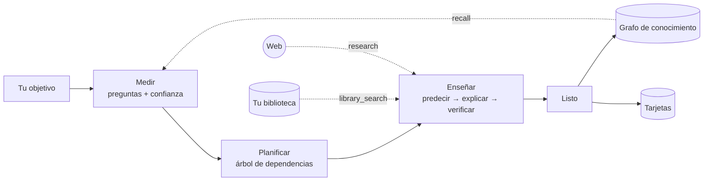
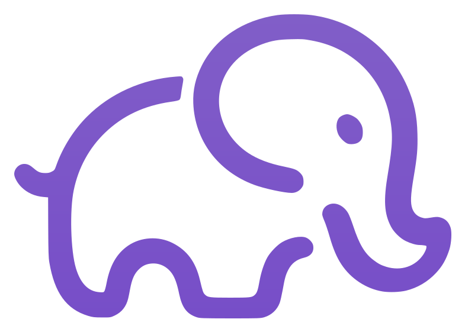

<div align="center">


# Eureka

### El tutor con IA que primero averigua qué sabés, y recién después te enseña.

**Entendé, no memorices.** Eureka mide dónde termina tu comprensión, arma un camino desde ahí hasta tu objetivo y te acompaña paso a paso hasta el momento *¡eureka!*.

[](https://tauri.app)
[](https://www.rust-lang.org)
[](https://react.dev)
[](#-tus-datos-son-tuyos)
[](#-traé-tu-propio-modelo)

[Qué es](#-qué-es-eureka) · [Funciones](#-todo-lo-que-trae) · [Instalar](#-empezá-en-2-minutos) · [Cómo funciona](#-cómo-funciona-por-dentro) · [Contribuir](#-contribuí)

</div>

---

## 🐘 Qué es Eureka

La mayoría de los chats con IA te tiran una respuesta. Eureka hace lo que haría un buen profesor particular:

1. **Mide.** Antes de explicar nada, te hace preguntas cortas para encontrar el borde exacto de lo que ya entendés.
2. **Planifica.** Arma un árbol de dependencias visible, desde lo que ya sabés hasta tu objetivo.
3. **Enseña.** Un paso por vez: primero predecís, después te explica y al final verifica que lo entendiste. Las confusiones se reparan antes de seguir.

Cada respuesta lleva tu **confianza (1 a 5)** y, si querés, tu **razonamiento en voz alta**. Así Eureka ve *cómo* pensás, no solo si acertaste. Un acierto con confianza baja todavía no es dominio, y un error con confianza alta pasa al frente de la fila.

> Es un elefante porque los elefantes no olvidan. Eureka recuerda lo que entendiste, tus confusiones y cómo aprendés mejor, y lo usa en cada sesión nueva.

## ✨ Por qué es distinto

| | Un chat de IA común | **Eureka** |
|---|---|---|
| Punto de partida | Explica desde cero, o da por sabido lo que no sabés | **Mide primero** y arranca en tu borde |
| Ruta | Respuestas sueltas | **Plan visible** con dependencias |
| Verificación | "¿Se entendió?" | **Preguntas de predicción y de chequeo**, con confianza |
| Memoria | Se olvida al cerrar el chat | **Grafo de conocimiento + perfil del aprendiz** |
| Tu bibliografía | Le pegás pedazos | **Biblioteca local** indexada, con citas a libro y página |
| Privacidad | Todo en la nube | **Todo en tu PC**; solo hablás con el proveedor que elijas |
| Modelo | El que te toque | **El que vos quieras**, por rol |

## 🎒 Todo lo que trae

### Aprender cualquier cosa
- **Sesiones guiadas** que pasan por medir, planificar, enseñar y cerrar, con preguntas de opción múltiple o abiertas.
- **Diagramas** (Mermaid), **demos interactivas** aisladas y **código** listo para correr, solo cuando el contenido lo pide.
- **Investigación web** con fuentes citadas [1], [2], solo cuando hace falta.
- **Tarjetas de memoria** que el propio profesor genera al cerrar cada idea.

### 🧠 Una memoria que crece con vos
- **Grafo de conocimiento:** al terminar una sesión, lo que entendiste queda guardado como ideas y razonamientos conectados. Importá tus notas, navegá el grafo y olvidá una fuente con un clic.
- **Perfil del aprendiz:** tus confusiones (reparadas o no) y cómo aprendés mejor. Lo ves y lo borrás en Ajustes.
- **`recall`:** el profesor consulta tu memoria antes de reenseñarte algo que ya sabés.

### 📚 Tu biblioteca, digerida en segundos
- Subí **PDFs, .txt o .md**: se convierten a Markdown **en tu PC**, sin API y sin gastar un token. Detecta capítulos, saca encabezados y números de página, y une palabras cortadas.
- Búsqueda **BM25 local**: un libro de 500 páginas se importa, indexa y consulta en **menos de un segundo**.
- El profesor **busca primero en tu bibliografía** y te cita **libro, sección y página**. Si una cita no salió de tu biblioteca, la app la marca como *no verificada*.
- La carpeta se puede abrir tal cual en **Obsidian**.

### 🎓 Exámenes y certificaciones
- Pegá la guía oficial (AWS, Google Cloud, Azure, Oracle, IBM, inglés…), cargala desde un **PDF** o **buscala en la web**, y se arma una **ruta de estudio** ponderada por el peso de cada dominio.
- **Simulacros** con o sin tiempo límite, corregidos al instante, con **repaso de falladas** hasta que las aciertes dos veces seguidas.
- **"¿Estoy listo?"** con tendencia y nota de aprobación, **plan hasta la fecha del examen**, **hoja de repaso** y **"¿por qué no la B?"**.

### 💻 Programación de verdad
- **Consola** para **Python, JavaScript, TypeScript y Rust**, con editor y ejecución en tu PC.
- Errores con su línea, chequeo de tipos de TypeScript y **"Explicar este error"**.
- **Rutas por lenguaje**, ejercicios con pruebas ocultas, **proyectos de varios archivos** (`cargo test`, `unittest`, `node --test`) y **"Revisá mi código"** como lo haría un senior.

### 🗣️ Idiomas
- **Listening** leído en voz alta y **speaking** con tu voz transcripta y corregida.

### ⏱️ Organización de estudio
- **Hoy:** qué te toca: clases, tarjetas y el tema de cada examen.
- **Pomodoro** con tiempo registrado por tema.
- **Materias** con su programa, **horario de clases**, **Agenda** semanal y **recordatorios** de Windows.
- **Exportá la agenda** (.ics) a Google Calendar u Outlook.
- **Tarjetas** con repetición espaciada (SM-2), importación y exportación con **Anki**.
- **Fotos y PDFs escaneados** leídos con visión y **respaldo completo** en un .zip.

## 🔒 Tus datos son tuyos

- Todo vive en tu PC: sesiones, grafo, biblioteca, tarjetas, perfil.
- Las API keys se guardan aparte y **nunca** entran en los respaldos.
- La biblioteca se convierte y se busca **sin red**.
- El código que escribís corre **solo cuando vos tocás Ejecutar**.

## 🔌 Traé tu propio modelo

Eureka habla con cualquier proveedor compatible con OpenAI: **OpenRouter, OpenAI, Anthropic, Gemini, DeepSeek, Groq**, o tu propio servidor. Asigná un modelo por rol para gastar menos:

| Rol | Qué hace | Sugerencia |
|---|---|---|
| Profesor | Enseña y decide el plan | Tu mejor modelo |
| Diagnóstico | Mide lo que ya sabés | Uno rápido |
| Extractor | Guarda lo aprendido en el grafo y resume sesiones largas | Uno barato |
| Práctica | Genera y corrige ejercicios | Uno barato |
| Investigador | Resume la web con fuentes | Uno barato |
| Voz | Transcribe tu speaking | Whisper o similar |

El harness está pensado para **gastar pocos tokens**:
- compacta el historial y resume las sesiones largas;
- muestra a cada fase solo sus herramientas;
- manda fragmentos cortos de tu bibliografía en vez de libros enteros;
- deja que configures el contexto de cada modelo.

## 🚀 Empezá en 2 minutos

> Los instaladores para Windows, macOS y Linux van a estar en **Releases**. Mientras tanto, se compila en un par de comandos.

**Requisitos:** [Rust](https://rustup.rs) estable (MSVC en Windows), [Node](https://nodejs.org) 22.22+ o 24.8+ y una API key de algún proveedor.

```bash
git clone https://github.com/<tu-usuario>/eureka.git
cd eureka
npm install
npm run app          # abre la app de escritorio
```

**Abrir la app en Windows, sin terminal:** en la raíz del proyecto está `Eureka.exe`: doble clic y listo (necesita WebView2, que ya trae Windows 11). Si cambiás el código, `Actualizar-Eureka.bat` lo reconstruye y reemplaza el ejecutable. Esa versión es la de desarrollo (abre también una ventana de consola); para un `.exe` liviano y sin consola, `npx tauri build`.

Después:
1. **Ajustes:** cargá tu API key, elegí el modelo del *Profesor* y guardá.
2. **Nueva sesión:** escribí qué querés entender ("qué es una derivada", "cómo funciona TCP", "el ciclo de Krebs"…).
3. Respondé con tu confianza y dejá que Eureka encuentre tu borde.

Para generar el instalador:

```bash
npx tauri build
```

**Atajos:** <kbd>Ctrl</kbd>+<kbd>K</kbd> abre la paleta de comandos. Los prompts del agente se editan en **Ajustes → Prompts**. Para que investigue en la web, cargá una key compatible con Tavily en **Ajustes → Búsqueda web**.

## 🧩 Cómo funciona por dentro



- **Backend en Rust (Tauri 2):**
  - un loop de agente con herramientas tipadas: `ask_question`, `set_plan`, `update_node`, `recall`, `library_search`, `research`, `make_cards`…;
  - transiciones de fase validadas y un reintento inteligente cuando el modelo devuelve algo inválido;
  - gestión de contexto con ventana, compactación y resumen acumulado.
- **Frontend en React:** interfaz estilo Linear, oscura por defecto, con KaTeX, Mermaid, CodeMirror y pdf.js.
- **Pedagogía con evidencia:** producir antes de recibir, prioridad a los errores con confianza alta, andamiaje adaptado al nivel y feedback sobre el razonamiento. Ver [docs/marco-pedagogico.md](docs/marco-pedagogico.md).

## 🧪 Hecho con disciplina

Eureka se construyó con **SDD + TDD + BDD**: cada función tiene su criterio de aceptación, su escenario en Gherkin y sus pruebas.

- **Rust:** más de 160 pruebas, incluido el loop del agente contra un proveedor falso.
- **Frontend:** más de 160 pruebas con Vitest.
- **E2E:** más de 100 escenarios en un navegador visible, más pruebas sobre la app de escritorio real.
- **Ninguna prueba gasta tokens.**

```bash
npm test             # tipos + Vitest + cargo test
npm run test:e2e     # e2e web en un navegador visible
npm run test:all     # todo
```

| Doc | Contenido |
|---|---|
| [docs/spec.md](docs/spec.md) | Criterios de aceptación y trazabilidad |
| [docs/design.md](docs/design.md) | Arquitectura, loop del agente, datos e IPC |
| [docs/auditoria-harness.md](docs/auditoria-harness.md) | Auditoría de memoria, contexto y herramientas del agente |
| [docs/testing.md](docs/testing.md) | Cómo correr y extender las pruebas |
| [features/](features) | Escenarios BDD en español |

## 🗺️ Lo que viene

- Instaladores firmados en Releases.
- Leer el tamaño de contexto directamente del proveedor.
- Exportar mazos `.apkg` de Anki.
- Ejecución de código aislada.
- Investigación en segundo plano.
- EPUB en la biblioteca.

## 🤝 Contribuí

¿Encontraste un bug, tenés una idea o querés sumar un idioma? Abrí un *issue* o mandá un *pull request*. Antes de proponer una función, mirá [docs/spec.md](docs/spec.md): cada cambio entra con su criterio de aceptación y sus pruebas.

## 📄 Licencia

[AGPL-3.0](LICENSE): podés usarla, estudiarla, cambiarla y compartirla; si distribuís una versión modificada (o la ofrecés como servicio), publicá también su código con la misma licencia.

<div align="center">
<br/>

<br/>
<sub>Hecho para que cada estudiante tenga su momento <b>¡eureka!</b></sub>
</div>
